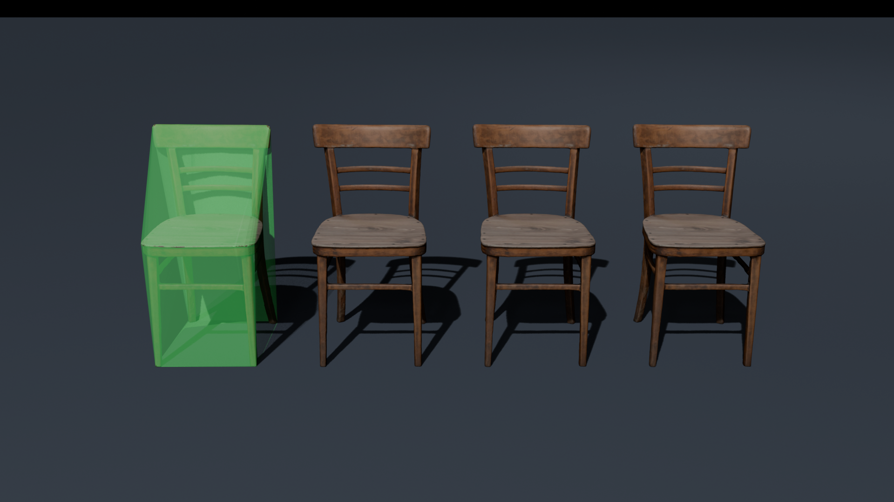
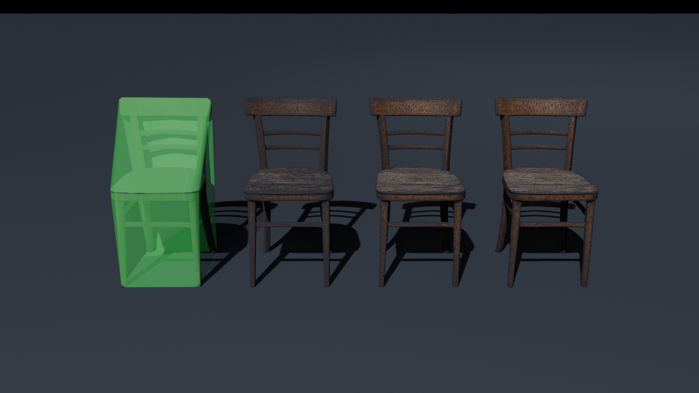
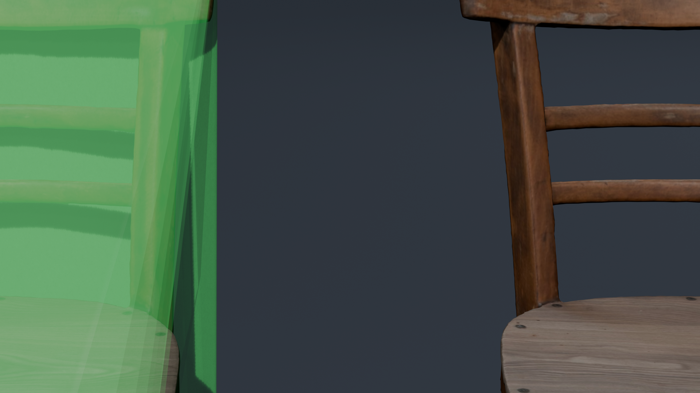
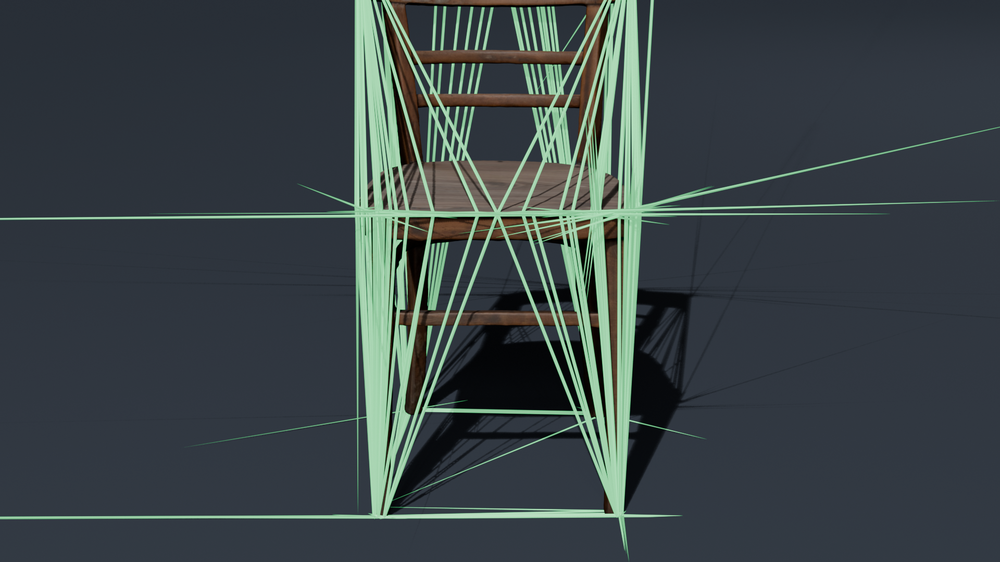

# Procedural LOD Generator Pro for Blender

[](https://www.blender.org/)
[](LICENSE)
[](#integration-moteurs)
[](#tests-automatises)

**Procedural LOD Generator Pro** est un add-on pour **Blender 4.x et 5.x** automatisant la génération de **LODs (Levels of Detail)** optimisés pour les moteurs de jeu en temps réel (**Unreal Engine 5**, **Unity URP/HDRP**, **Godot 4.x**, **WebXR / Three.js**).

Il résout les limitations inhérentes à une décimation géométrique classique (ruptures de coutures UV, distorsions de textures, artefacts d'ombrage et instabilités de normales) en combinant protection topologique, détection de courbure 2D dans l'espace UV, contraintes natives C++ et transfert de normales depuis le maillage source.

---

## Showcase et Benchmarks

*Évaluation réalisée sur le modèle de production Blendkit **Vintage Wooden Chair** (145 588 triangles d'origine).*

### 1. Rendu Texturé Comparatif


| Palier | Triangles | Réduction | Seuil d'écran recommandé | Utilisation cible |
| :--- | :---: | :---: | :---: | :--- |
| **LOD 0** | **145 588** | **0.0%** | $100\% - 50\%$ | Modèle haute définition au premier plan |
| **LOD 1** | **72 794** | **-50.0%** | $50\% - 25\%$ | Distance moyenne, silhouette préservée |
| **LOD 2** | **36 396** | **-75.0%** | $25\% - 12\%$ | Vue éloignée, suppression des micro-détails |
| **LOD 3** | **18 198** | **-87.5%** | $< 12\%$ | Arrière-plan, optimisation polygonale maximale |

---

### 2. Topologie et Réduction Polygonale


La décroissance polygonale est uniforme et conserve les arêtes de silhouette ainsi que la courbure générale des éléments structurels.

---

### 3. Préservation des UVs et Continuité de Texture


Inspection de la tranche incurvée du dossier : la combinaison de la détection de courbure dans l'espace UV, des délimitations strictes et de la pré-triangulation élimine les étirements de textures et les inversions de polygones sur les coutures.

---

### 4. Génération du Maillage de Collision (UCX)


Génération automatique d'un maillage de collision simplifié `UCX_[Nom]_01` conforme aux exigences d'Unreal Engine et de Unity.

---

## Fonctionnalités

- **Barrière topologique native C++ (`delimit={'UV', 'MATERIAL', 'SEAM'}`) :** Empêche le solveur QEM de fusionner des sommets appartenant à des îlots UV disjoints.
- **Pré-triangulation (`BEAUTY` + `CLIP` + préservation des normales) :** Convertit le maillage source en triangles réguliers avant réduction pour éviter la création de N-gons concaves et les étirements de texture.
- **Détection de courbure 2D dans l'espace UV :** Détecte les variations angulaires dans le plan UV afin de figer les zones de courbure critique.
- **Projection barycentrique via BVHTree :** Corrige les déformations résiduelles par projection spatiale depuis la surface LOD0 d'origine.
- **Transfert de données de normales (Data Transfer) :** Projette les normales scindées personnalisées (*Custom Split Normals*) depuis le LOD0 pour éliminer les variations d'ombrage entre niveaux.
- **Filtrage des composants géométriques isolés (BFS) :** Détecte et élimine par parcours de graphe les éléments de petite dimension (visserie, rivets) sur les niveaux distants.
- **Hiérarchie standard `LodGroup` :** Génère un conteneur Empty configuré pour l'importation automatique sous Unreal Engine et Unity.
- **Outils d'inspection intégrés :**
  - **Vue éclatée :** Décalage des niveaux le long de l'axe X pour contrôle visuel simultané.
  - **Aperçu interactif selon la distance caméra :** Simulation en temps réel du basculement des LODs selon la formule :
    $$\text{ScreenSize} = \frac{2 \cdot R}{d \cdot \tan(\text{FOV}/2)}$$
  - **Visualisation du masque de pondération :** Contrôle des poids de protection en mode Weight Paint.

---

## Installation

### Installation via archive ZIP
1. Téléchargez [`lod_generator_addon.zip`](releases/lod_generator_addon.zip) depuis le dossier `releases/`.
2. Dans Blender, ouvrez **Edit** > **Preferences** > **Add-ons** (ou **Get Extensions**).
3. Ouvrez le menu contextuel en haut à droite > **Install from Disk...**
4. Sélectionnez l'archive `.zip` et activez **Procedural LOD Generator Pro**.

### Installation manuelle
Copiez le dossier `lod_generator_addon` dans le répertoire d'add-ons correspondant à votre système :
- **Windows :** `%APPDATA%\Blender Foundation\Blender\<version>\scripts\addons\`
- **Linux :** `~/.config/blender/<version>/scripts/addons/`
- **macOS :** `~/Library/Application Support/Blender/<version>/scripts/addons/`

---

## Utilisation

1. Sélectionnez le maillage cible dans la vue 3D.
2. Ouvrez le panneau latéral avec la touche **`N`** et accédez à l'onglet **LOD Generator**.
3. Définissez les paramètres de génération :
   - Nombre de niveaux (ex: 3 pour générer LOD1, LOD2, LOD3).
   - Profil de réduction : exponentiel ($0.5^k$), linéaire, cinématique ($0.7^k$) ou manuel.
   - Activez les options de protection topologique et de préservation UV.
4. Cliquez sur **Générer les LODs**.
5. Contrôlez les niveaux à l'aide des fonctions **Vue éclatée** ou **Distance caméra**.
6. Exportez le résultat au format FBX ou glTF.

### Qualité de décimation

- **Mode de réduction** (section 2) : *Pourcentage* (preset classique), *Budget d'erreur* (« réduis tant que l'écart reste sous 2 mm », tolérance multipliée à chaque niveau) ou *Taille écran* (écart toléré déduit du seuil d'écran de chaque LOD et d'une erreur en pixels). L'écart réellement mesuré (Hausdorff avec LOD0) est affiché dans le tableau de statistiques.
- **Remesh avant décimation** (section 5) : *Voxel* (fusionne les îlots, referme les trous) ou *QuadriFlow* (quads propres, repli sur Voxel si besoin) pour les scans, sculpts et kitbash. UVs et matériaux sont restaurés depuis la source.
- **Bake normales & AO** (section 6) : les détails de LOD0 sont bakés (Cycles) sur les LODs lointains, dans des copies de leurs matériaux. Si les UVs se chevauchent ou sont tuilées, un calque `LOD_BakeUV` est créé automatiquement.
- **Imposteur** (section 6) : dernier niveau en billboard « étoile » (8 ou 16 vues capturées dans un atlas), idéal pour la végétation et les décors lointains.


---

## Intégration Moteurs

### Unreal Engine 5
- Importez le fichier `.fbx` généré.
- La métadonnée `LodGroup` est détectée nativement par Unreal Engine, qui configure automatiquement les paliers de LOD.
- Le maillage `UCX_[Nom]_01` est assigné en tant que collider de collision complexe.

### Unity (URP / HDRP)
- Déposez le fichier `.fbx` dans le répertoire du projet.
- Unity applique automatiquement le composant `LOD Group` avec les seuils d'écran associés.

### Godot 4.x
- Importez le fichier `.glb`.
- Les suffixes `_LOD0`, `_LOD1` et les maillages de collision sont pris en charge par le pipeline d'importation de scènes 3D.

---

## Tests Automatisés

Le projet comprend une suite de validation exécutable en mode arrière-plan (*headless*) :

```powershell
& "C:\Program Files (x86)\Steam\steamapps\common\Blender\blender.exe" --background --python "tests/test_lod_generator.py"
```

```text
======================================================================
  DEBUT DES TESTS UNITAIRES : PROCEDURAL LOD GENERATOR
======================================================================
--- Test 1: Enregistrement de l'Add-on ---                                [OK]
--- Test 2: Audit Topologique et Detection d'Ilots (BFS) ---             [OK]
--- Test 3: Carte de Protection et Ponderation (Vertex Group) ---        [OK]
--- Test 4: Pipeline Complet de Generation de LODs ---                   [OK]
--- Test 5: Vue Eclatee (Exploded View) ---                              [OK]
--- Test 6: Exportation Moteur (FBX et glTF) ---                         [OK]
--- Test 7: Algorithmes Avances de Preservation des UVs ---              [OK]
--- Test 8: Nettoyage et Reinitialisation ---                            [OK]
--- Test 8b: Coque a double paroi (ballon, solidify) ---                  [OK]
--- Test 12: Budget d'erreur et taille ecran ---                           [OK]
--- Test 13: Remesh Voxel / QuadriFlow avant decimation ---               [OK]
--- Test 14: Bake normales & AO + imposteur billboard ---                 [OK]
======================================================================
  TOUS LES TESTS SONT PASSES AVEC SUCCES.
======================================================================
```

---

## Licence et Auteur

Développé par **Dylan Belledent** ([@dyzlek](https://github.com/dyzlek)).

Distribué sous licence **MIT**. Consulter le fichier [LICENSE](LICENSE) pour plus de détails.
